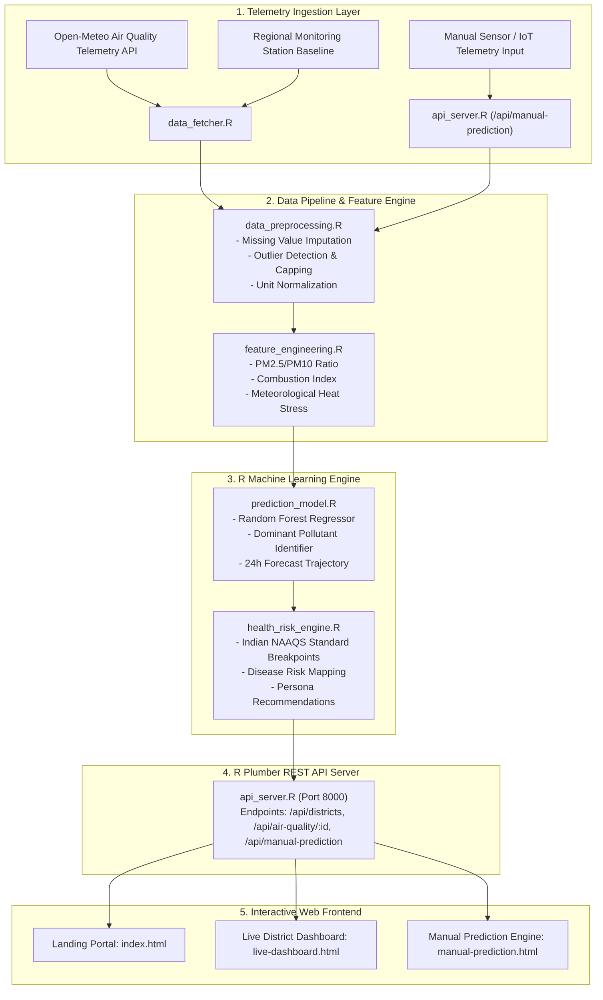

# AeroSense TN — Tamil Nadu Air Quality Predictor & Health Risk Intelligence

> **Tagline:** *“Understand the Air. Predict the Risk.”*

A modern, scientific environmental intelligence web application that monitors, predicts, and analyzes air quality and associated disease risks across all **38 districts of Tamil Nadu**, powered by an **R-First Machine Learning backend (Plumber REST API & Random Forest)** and an interactive **Hallmark-designed Frontend**.

---

## 1. Project Overview

**AeroSense TN** is an environmental intelligence system designed to predict the **Air Quality Index (AQI)** from atmospheric telemetry (PM2.5, PM10, NO₂, SO₂, CO, O₃, NH₃, Temperature, Humidity, Wind Speed) and map the results to clinical disease risks and personalized safety protocols.

### Key Capabilities:
- **Method 1: Live District Dashboard (`live-dashboard.html`)**: Real-time telemetry ingestion across all 38 Tamil Nadu districts from public monitoring APIs, automated preprocessing pipeline, 24-hour predictive forecast trajectories, multi-district benchmark comparisons, and clinical health vulnerability mapping.
- **Method 2: Manual Prediction Mode (`manual-prediction.html`)**: Custom telemetry entry from portable air sensors or IoT hardware with instantaneous R Random Forest model inference and health impact assessment.

---

## 2. Technology Stack

### Backend (R-First Architecture)
- **Runtime:** R Programming Language (v4.0+)
- **REST API Framework:** R Plumber (`plumber` package) on `http://127.0.0.1:8000`
- **Machine Learning Engine:** Random Forest Regressor (`randomForest` package, 500 trees)
- **Data Manipulation & Parsing:** `dplyr`, `readr`, `jsonlite`
- **Networking & HTTP:** `curl`, `httr`, `httpuv`
- **Model Serialization:** R binary format (`model.rds`)

### Frontend (Preserved Native Architecture)
- **Structure & Logic:** HTML5, CSS3, Vanilla JavaScript (ES6+ Modules)
- **Data Visualization:** Chart.js (24-hour predictive forecast curve and pollutant comparison radar)
- **Design System:** Hallmark-inspired design system with modern typography (Space Grotesk & Inter), glassmorphism cards, and responsive CSS breakpoints
- **Static Hosting:** Lightweight R-based HTTP server (`httpuv`) on `http://localhost:5500`

### Process Orchestration & Launchers
- **Windows Launcher:** Native Windows Batch (`run.bat`)
- **PowerShell Launcher:** Native PowerShell (`run.ps1`)
- **Single-Command R Launcher:** Pure R script (`run.R`) that manages ports, verifies dependencies, trains missing models, and hosts both frontend and backend concurrently without requiring Python.

---

## 3. System Architecture Diagram



---

## 4. Project Directory Structure

```text
Air Quality Prediction/
├── backend/
│   ├── api_server.R            # Plumber REST API routing, CORS & validation controllers
│   ├── data_fetcher.R          # Real-time telemetry ingestion for 38 TN districts
│   ├── data_preprocessing.R    # Validation, outlier detection & pipeline status logs
│   ├── feature_engineering.R   # Multi-pollutant & meteorological feature extraction
│   ├── prediction_model.R      # Random Forest ML model & 24h predictive trajectory
│   ├── health_risk_engine.R    # NAAQS classification, disease mapping & persona advice
│   ├── requirements.R          # R package dependency verification and reporting
│   ├── model.rds               # Serialized Random Forest model binary
│   ├── model_metadata.json     # Verified model training evaluation metrics
│   ├── train.R                 # End-to-end Random Forest training and evaluation script
│   ├── train_model.R           # Compatibility wrapper calling train.R
│   └── dataset/
│       └── air_quality.csv     # Historical atmospheric training dataset (1200 records)
├── frontend/
│   ├── index.html              # Main landing portal & project introduction
│   ├── live-dashboard.html     # District-wise interactive telemetry dashboard
│   ├── manual-prediction.html  # Dedicated manual sensor prediction page
│   ├── css/
│   │   ├── style.css           # Hallmark design system, typography & glassmorphism
│   │   └── responsive.css      # Mobile, tablet & desktop breakpoint rules
│   └── js/
│       ├── api.js              # REST API client connecting to R Plumber
│       ├── charts.js           # Chart.js visualization engine
│       ├── app.js              # Live dashboard controller & ticker
│       └── manual-prediction.js# Manual form validation & report generator
├── scratch/
│   ├── test_suite.R            # Automated 21-point verification suite in Pure R
│   └── test_suite.py           # Automated 21-point verification suite in Python
├── run.bat                     # Windows batch launcher (checks R and runs run.R)
├── run.ps1                     # PowerShell launcher script
├── run.R                       # Single-command R application launcher
├── HOW_TO_RUN.md               # Quick execution instructions
├── SINGLE_COMMAND_RUN_GUIDE.md # Detailed single-command runner guide
├── package.json                # Project descriptor with R script commands
├── .env.example                # Environment configuration template
└── README.md                   # Complete documentation
```

---

## 5. Machine Learning Model Training & Evaluation

The predictive engine uses an ensemble **Random Forest Regressor** trained directly in R on historical air quality telemetry across Tamil Nadu.

### Training Procedure (`backend/train.R`)
1. Ingests atmospheric data (`dataset/air_quality.csv`, 1200 records).
2. Cleans records by removing duplicate observations and enforcing physical sanity bounds.
3. Partitions data into an **80% training set** (960 samples) and an independent **20% testing set** (240 samples) with a fixed seed (`seed = 42`) to strictly prevent data leakage.
4. Trains 500 decision trees (`ntree = 500`, `mtry = 3`) using the `randomForest` R package.
5. Evaluates model performance on the unseen evaluation test set.

### Verified Evaluation Results
- **Test Coefficient of Determination ($R^2$):** `0.9577` (95.8% of atmospheric AQI variance explained)
- **Test Root Mean Squared Error (RMSE):** `14.52 AQI units`
- **Test Mean Absolute Error (MAE):** `10.03 AQI units`
- **Out-of-Bag (OOB) $R^2$:** `0.9604`
- **Out-of-Bag (OOB) RMSE:** `15.02 AQI units`

### Feature Importance Ranking (%IncMSE)
1. **NO₂** (59.13)
2. **O₃** (42.21)
3. **PM2.5** (31.97)
4. **CO** (26.45)
5. **Temperature** (24.58)
6. **Wind Speed** (23.07)
7. **PM10** (22.54)
8. **SO₂** (21.95)
9. **Humidity** (5.39)

To retrain the model at any time:
```powershell
Rscript backend/train.R
```

---

## 6. Installation & Prerequisites

### Prerequisites
- **R Programming Language (v4.0 or later)** installed and added to your system `PATH`.
  - Download from: [https://cloud.r-project.org](https://cloud.r-project.org)
  - Verify installation in terminal: `Rscript --version`

### Required R Packages
The following packages are verified automatically on launch by `backend/requirements.R`:
- `plumber` (v1.3+)
- `randomForest` (v4.7+)
- `jsonlite` (v2.0+)
- `readr` (v2.2+)
- `dplyr` (v1.2+)
- `curl` (v8.1+)
- `httr` (v1.4+)
- `httpuv` (v1.6+)

To manually verify or install all packages:
```powershell
Rscript backend/requirements.R
```

---

## 7. Starting the Application

### Option A: Windows Batch Launcher (Recommended)
Double-click `run.bat` or run in Command Prompt:
```cmd
run.bat
```

### Option B: PowerShell
```powershell
.\run.ps1
```

### Option C: Direct Rscript Execution
```powershell
Rscript run.R
```

### What Happens Automatically:
1. Verifies that `Rscript` is available in PATH.
2. Frees ports `8000` and `5500` if previously occupied.
3. Verifies all R package dependencies via `backend/requirements.R`.
4. Verifies the existence of `backend/model.rds` (trains automatically if missing).
5. Starts the static HTTP frontend server on `http://localhost:5500`.
6. Opens `http://localhost:5500` in your default browser.
7. Starts the R Plumber REST API server on `http://127.0.0.1:8000`.
8. Provides a clean shutdown when `Ctrl + C` is pressed.

---

## 8. REST API Reference

The backend exposes RESTful JSON endpoints on `http://127.0.0.1:8000`:

| Method | Endpoint | Description |
|---|---|---|
| `GET` | `/api/health` | Backend status, R version, model metadata, and supported district count |
| `GET` | `/api/districts` | Directory of all 38 Tamil Nadu districts, geographic coordinates & zones |
| `GET` | `/api/live-data` | Telemetry summary and AQI benchmarks across major regional hubs |
| `GET` | `/api/air-quality/:district` | Telemetry, Random Forest prediction, and disease mapping for a district (returns 404 if invalid) |
| `GET` | `/api/prediction/:district` | 24-hour diurnal predictive forecast trajectory and confidence intervals |
| `POST` | `/api/manual-prediction` | Random Forest inference from custom sensor inputs (validates missing, non-numeric, and out-of-range inputs) |
| `GET` | `/api/data-status` | Telemetry availability, preprocessing pipeline status, and model metrics |

### Example Manual Prediction Request
```bash
curl -X POST http://127.0.0.1:8000/api/manual-prediction \
  -H "Content-Type: application/json" \
  -d '{
    "district": "Custom Sensor Station",
    "pm25": 42.5,
    "pm10": 78.0,
    "no2": 24.0,
    "so2": 6.5,
    "co": 0.85,
    "o3": 30.0,
    "temperature": 29.0,
    "humidity": 55.0,
    "windSpeed": 12.0,
    "persona": "sensitive"
  }'
```

---

## 9. Disease Risk Mapping & Clinical Intelligence

AeroSense TN analyzes air quality levels against authoritative Indian National Air Quality Index (NAAQS) standards to assess potential disease triggers across 5 clinical categories:

1. **Asthma Exacerbation & Bronchospasm** (Key Triggers: PM2.5, NO₂, O₃)
2. **Acute Bronchitis & Upper Airway Inflammation** (Key Triggers: PM10, SO₂, NO₂)
3. **Cardiovascular Strain & Endothelial Stress** (Key Triggers: PM2.5, CO)
4. **COPD & Chronic Pulmonary Complications** (Key Triggers: PM2.5, PM10, O₃)
5. **Allergic Rhinitis & Conjunctival Irritation** (Key Triggers: PM10, Ozone, SO₂)

### Persona-Tailored Advisory
- **Sensitive / Asthma Patients:** Inhaler preparedness protocols, N95 respirator recommendations, exertion boundaries.
- **Children & Senior Citizens:** Playground timing advisories and indoor hydration protocols.
- **Outdoor Athletes & Runners:** Particulate pulmonary deposition warnings and indoor workout suggestions.
- **Outdoor & Construction Workers:** Mandatory filtered rest zone rotation schedules and heavy-duty dust respirator guidance.
- **General Population:** Room ventilation timing and vehicular cabin recirculation advice.

---

## 10. Automated Verification Test Suites

The project includes dual automated verification suites testing all 21 key operational criteria:

### Running via R (Native R Test Suite):
```powershell
Rscript scratch/test_suite.R
```

### Running via Python (Compatibility Test Suite):
```powershell
python scratch/test_suite.py
```

Both test suites verify:
- API health and version response.
- All 38 Tamil Nadu districts.
- Live telemetry ingestion and transparency metadata.
- Strict district identifier validation (HTTP 404 for unknown districts).
- 24-hour predictive trend generation.
- Manual prediction execution and dominant pollutant detection.
- Negative testing: strict HTTP 400 rejection for missing parameters, non-numeric values, and out-of-range sensor readings.
- Pipeline status reporting.
- Frontend static asset delivery across all pages, CSS, and JavaScript modules.

---

## 11. Troubleshooting

| Issue | Cause | Resolution |
|---|---|---|
| `'Rscript' is not recognized` | R is not installed or not in PATH | Install R 4.0+ from [cloud.r-project.org](https://cloud.r-project.org) and add `C:\Program Files\R\R-4.x.x\bin` to system PATH. |
| Port 8000 or 5500 already in use | Lingering process from earlier run | `run.R` automatically frees these ports; or run `taskkill /F /PID <pid>` manually after identifying with `netstat -ano \| findstr :8000`. |
| `model.rds` not found | First-time setup | `run.R` will automatically train the model; or execute `Rscript backend/train.R` manually. |
| External telemetry marked "Estimated Baseline" | Monitoring API offline or rate-limited | The application automatically switches to regional historical baselines and sets `is_live = FALSE` for full data transparency. |

---

## 12. Health & Environmental Disclaimer

> **Clinical Disclaimer:** AeroSense TN provides general environmental intelligence and predictive risk assessments based on atmospheric telemetry and statistical machine learning. It does not constitute medical diagnosis, clinical prognosis, or personalized healthcare treatment. Individuals with preexisting respiratory, cardiovascular, or other medical conditions should consult a qualified physician or healthcare professional.
